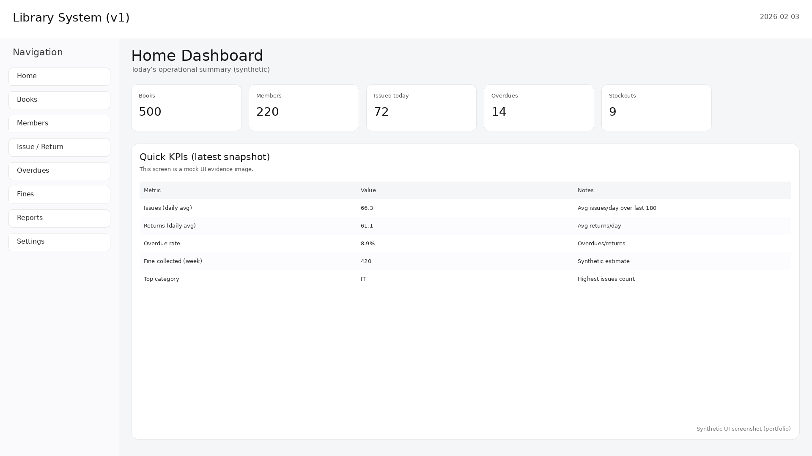
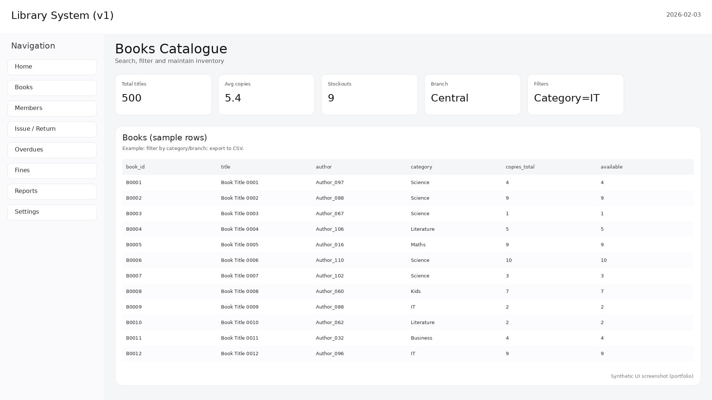
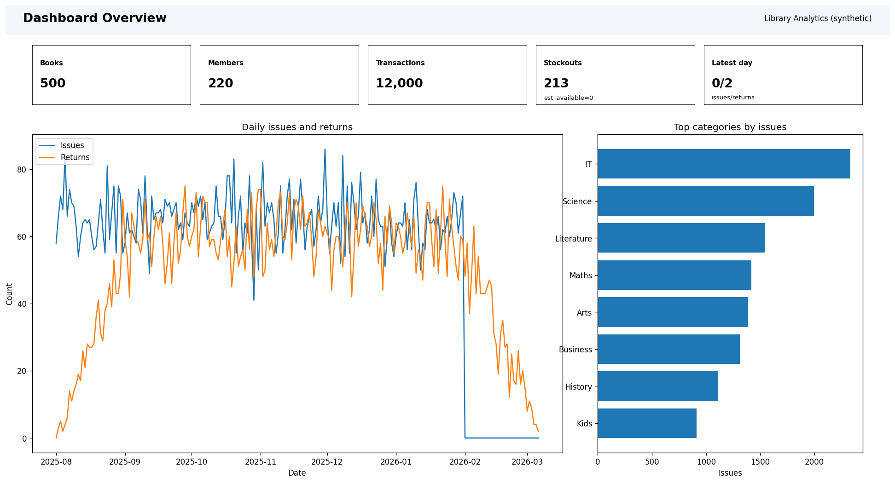
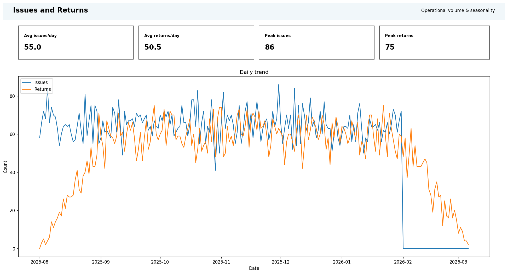
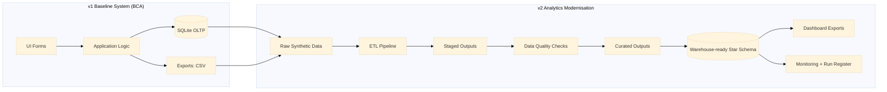

# Library Book Inventory & Issue Tracking System (BCA + Analytics Modernisation)

This repository is a **portfolio-safe, end-to-end project** that shows progression from a **BCA baseline system (v1)** to an **analytics modernisation layer (v2)**.

- **v1_bca_basic_system/** — CRUD-style workflow: Books → Members → Issue/Return → Fines → Reports/Exports  
- **v2_analytics_modernisation/** — synthetic data → ETL → Data Quality gate → curated outputs → warehouse model → dashboard exports + monitoring  

**Portfolio safety:** this repo contains **synthetic/demo data only** (no real member identities, no real borrowing history).  
Last updated: **2026-02-03**

---

## What you can review quickly (top evidence)

### v1 UI screenshots (baseline app)
Location: `v1_bca_basic_system/ui/screenshots/`

Preview:




### v2 Dashboard exports (Power BI-style PNG)
Location: `v2_analytics_modernisation/bi_powerbi/exports/`

Preview:




### Mermaid (architecture & KPI trees)
Mermaid sources: `docs/mermaid/`  
Start with:

- `docs/mermaid/architecture_flow.mmd`
- `docs/mermaid/kpi_tree.mmd`
- `docs/mermaid/warehouse_star_schema.mmd`

---

## Architecture at a glance (v1 + v2)



---

## How to run locally (portfolio demo)

### Prerequisites
- Python 3.10+ recommended

### v2 quick run
```bash
cd v2_analytics_modernisation
pip install -r requirements.txt

# 1) generate raw synthetic data
python scripts/make_sample_data.py

# 2) run the ETL to produce staged + curated outputs
python etl/run_etl.py

# 3) run data quality checks (JSON + HTML report)
python dq_data_quality/run_checks.py

# 4) generate dashboard exports (PNG)
python scripts/generate_bi_exports.py
```

Outputs you should see:
- `v2_analytics_modernisation/data/raw/`
- `v2_analytics_modernisation/data_output/staged/`
- `v2_analytics_modernisation/data_output/curated/`
- `v2_analytics_modernisation/reports/dq_summary.json`
- `v2_analytics_modernisation/reports/dq_report.html`
- `v2_analytics_modernisation/bi_powerbi/exports/*.png`

---

## Governance, QA and evidence packs

- **Governance logs:** `docs/logs/` (progress log, run register, issues log, hours)
- **QA / reproducibility:** `docs/quality/` (test strategy, DQ strategy, reproducibility checklist)
- **Evidence index:** `EVIDENCE_INDEX.md` (where to find the main proof artefacts)
- **Evidence images:** `docs/evidence/` (v1 UI, v2 pipeline, v2 BI, diagrams)
- **Sample runtime logs:** `logs/sample_logs_only/` (safe, no secrets)

---

## Repo map

- v1 baseline: `v1_bca_basic_system/`
- v2 analytics: `v2_analytics_modernisation/`
- Documentation packs: `docs/`
- Safe runtime logs: `logs/`

For a full file list, see **REFERENCE_FILE_STRUCTURE.md**.
