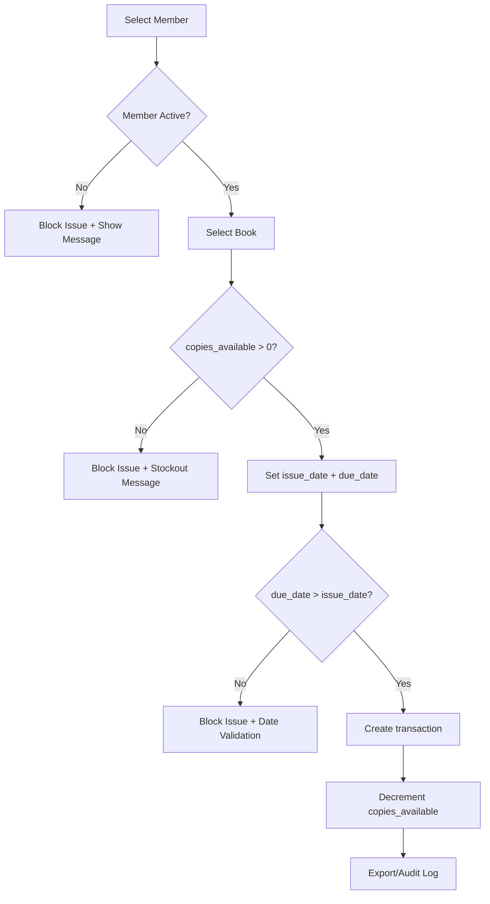
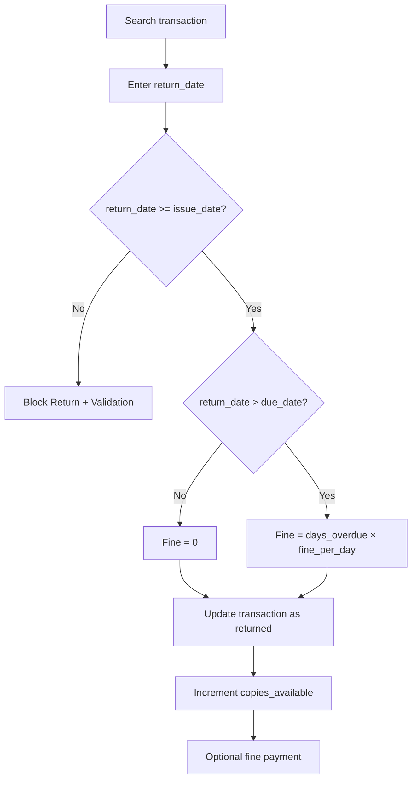

# Process Flows

## Issue flow



## Return flow



## Export flow (v1 → v2)

```mermaid
flowchart LR
  V1[v1 exports] --> RAW[v2 raw extract folder]
  RAW --> ETL[v2 ETL]
  ETL --> CUR[v2 curated KPI tables]
  CUR --> BI[Dashboard exports (PNG)]
```
