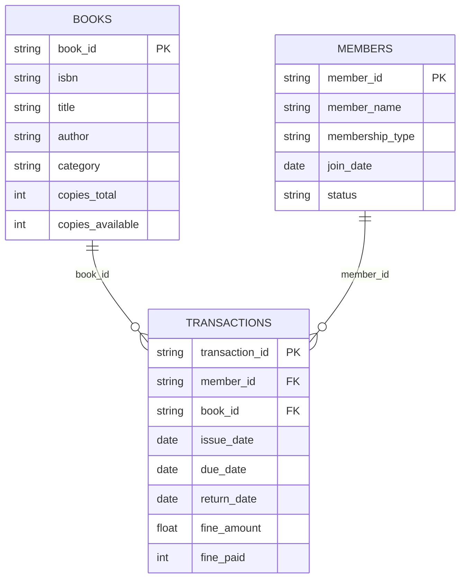

# Data Model

## OLTP (v1) — core entities

## Analytics (v2) — curated outputs
- Dimensions:
  - dim_book, dim_member, dim_branch, dim_category
- Facts:
  - fact_issue_return
  - fact_fines
- KPI tables:
  - kpi_daily_issues_returns, kpi_overdue_daily, kpi_fine_weekly, kpi_inventory_health, etc.
